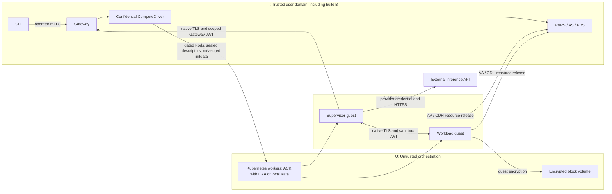

# Architecture and trust boundaries

Confidential OpenShell runs the unmodified OpenShell v0.1.9 Gateway, CLI and
supervisor with an external confidential Kubernetes ComputeDriver. The coding
workload uses the unmodified, digest-pinned OpenShell Community base image,
which includes OpenCode, Codex, Claude Code and their developer tools. The guest
uses the official Ubuntu mkosi/UKI flow and commit-pinned upstream AA/CDH. The
locked Trustee release provides appraisal and key release. Integration hooks add
measured OpenShell bootstrap and encrypted persistent workspaces. Native
OpenShell owns TLS, sandbox JWTs, RPC authorization and the supervisor/workload
protocol.

Native OpenShell generates TLS and JWT signing state through its Kubernetes
initialization Job/cert-manager or standalone certificate generator. This
profile uses the released generator on T and seals guest bootstrap instead of
distributing plaintext credentials through Kubernetes Secrets. See the pinned
[Helm deployment][helm-deployment] and
[certificate generator][certificate-generator].

The trusted user domain **T** contains build execution role **B**, the operator
CLI, Gateway, driver and its private authorization journals, and Trustee AS/KBS
and AS's built-in RVPS. Trustee may run on a separate trusted host. The driver
publishes resources and policies through authenticated KBS management APIs; its
private staging and recovery journal are never shared with Trustee. KBS proxies
policy and reference administration to AS. The deployment owns a dedicated KBS
resource policy and AS `openshell-tdx_cpu` policy; multiple independent policy
writers are not supported. KBS and Gateway expose authenticated TLS endpoints
reachable by the cloud guests. Their addresses do not define the trust boundary.
The official Trustee images run without source changes.

T belongs to the user and is deployed on user-trusted systems, such as an
on-premise host. ACK and the cloud provider do not need administrative access to
it. If the cloud host administrator is in the adversary model, an ordinary ECS
VM cannot supply this trust merely because the user owns the account.

Developers run the native CLI on their trusted machines and reach the Gateway's
public TLS endpoint in T.

T reaches the selected Kubernetes API. Guests reach Gateway, KBS and the image
registry over authenticated TLS. The two role guests form **G** and boot the
same immutable guest release. **U** includes Kubernetes, storage controllers
and workers. On bare metal it includes the host kernel, QEMU and storage
device presented to the VM. The host can change inputs or deny service.
Trustee appraises the measured boot and the current role binding before KBS
releases credentials. Each deployment selects one backend.

| | ACK Peer Pods | Native Kata on bare metal |
| --- | --- | --- |
| Boot and role binding | ECS TDVF and AAEL | Kata TDVF and MRCONFIGID |
| Network | Separate podns | Shared Pod network |
| Persistent storage | CSI, APF and CDH | [Transitional sidecar][limits], CDH |

On ACK, the ECS TDVF profile requires six ordered RTMR0 events, three static
digests and dynamic ACPI. AA records the exact initdata digest in the
canonical RTMR3 AAEL event. CAA configures the Pod network namespace (podns)
inside the remote VM; guest services use the VM network. CSI manages the
cloud disk, APF checks its measured identity and CDH opens it.

On bare metal, the Kata TDVF profile requires 16 RTMR0 events. The policy
pins static digests and accepts the VMM-provided TD HOB memory layout, ACPI
and handoff data for the approved TDVF to process. MRCONFIGID binds the exact
role initdata. Guest components and containers share the Pod network. The
deployment permits the workload PodVM to reach the trusted registry and KBS
IPv4 endpoints. The in-guest broker constrains agent egress.

The native driver records the PV UID. A sidecar identifies the Block device,
and a guest service initializes or reopens it and mounts ext4 for seed and
agent. The local PV example supports recovery on the same worker.

[limits]: ../deployment/baremetal/README.md#limitations

Both policies require approved MRTD and UKI boot measurements, CCEL replay
against the quoted registers, a non-debug TD and a current authorized digest.
The native HOB check authenticates the recorded measurement without approving
individual address ranges. See the
[Trustee policies](../deployment/trustee/README.md).

Resource isolation is between guest roles. This guest profile uses AA/CDH ttRPC
and disables REST activation (`api-server-rest.path`) by default. This service
setting does not isolate keys from a program with sufficient privileges inside
its own guest. Such a workload program can obtain its own workspace key; this
design does not isolate that key from programs inside the workload guest. KBS
rejects resources bound to the other role. Provider credentials are delivered to
the supervisor and remain outside the workload's resource bindings.

<table>
<thead>
<tr>
<th>Path</th>
<th>Contract</th>
</tr>
</thead>
<tbody>
<tr>
<td>Control</td>
<td>Gateway calls the external driver over its private socket. The driver
creates gated role Pods, derives Kata policy from T-owned launch
templates after checking admitted Pods, commits authorization and
verifies Pod identity before releasing scheduling gates. Kubernetes
receives sealed descriptors and references.</td>
</tr>
<tr>
<td>Attestation and release</td>
<td>Exact initdata bytes bind role, generation, attempt, Sandbox CR UID
and resources. AS verifies the quote, boot and backend-specific
initdata binding; KBS authorizes the exact resource under the driver's
current bindings. Kubernetes delivers signed vault descriptors through
normal Secret mounts; Kata invokes CDH to verify and unseal them
inside the guest.</td>
</tr>
<tr>
<td>Gateway authentication</td>
<td>Operators present their native client certificate. Supervisors verify
the Gateway's server CA and present native sandbox-scoped JWTs. The
driver seals launch/session credentials, per-role TLS server keys and
public trust material; the operator client private key never enters
either guest. Anonymous user access is disabled.</td>
</tr>
<tr>
<td>Workload channel</td>
<td>New workload generations establish the native control connection to
their dedicated supervisor. The supervisor still verifies the
workload's TLS server identity and authenticates with the native
sandbox JWT. A per-sandbox NetworkPolicy scopes supervisor control
flow to that pair. Native Kata also needs the deployment egress rules
above. The workload’s in-guest seccomp/network broker mediates
outbound connections; namespace and driver fences provide additional
isolation.</td>
</tr>
<tr>
<td>User environment</td>
<td>Template and <code>--env</code> values enter the existing sealed
workload configuration and reach child processes after CDH/KBS
release. Kubernetes receives descriptors without those values. A
private namespace/CR-UID record on T preserves them across stop/start.</td>
</tr>
<tr>
<td>Storage</td>
<td>The measured workload initializer obtains its key through CDH/KBS and
initializes new LUKS volumes with stock cryptsetup. Released CDH
SecureMount reopens encrypted volumes. The key identity remains stable
for namespace and Sandbox CR UID; each attempt receives a new release
binding. The provisioner and reclaim policy determine the volume
lifecycle.</td>
</tr>
<tr>
<td>Model requests</td>
<td>The supervisor obtains the attached provider credential at runtime and
uses the approved HTTPS endpoint. The external inference service
receives requests and is outside this confidential boundary.</td>
</tr>
</tbody>
</table>

Supervisors authenticate with sealed launch JWTs and native refresh. The
driver's `AuthenticateSandbox` rejects host-controlled ServiceAccount
credentials before TokenReview or Kubernetes API access.
`supports_sandbox_authentication=true` stays enabled because Gateway also uses
it to persist the runtime identity needed for stop/start; see the
[driver contract][driver-contract].

Attestation determines who receives a credential; subsequent TLS requests
authenticate its holder without fresh hardware appraisal at connection
establishment. A copied credential could authenticate elsewhere until it expires
or the native authorization state rejects it. KBS revocation blocks future
unseal; it cannot retract credentials or plaintext already delivered. Keep
sealed files guest-private, use fresh attempt bindings, and stop/delete the
native runtime when revoking an active run. Native checks of `auth_epoch` and
the current JWT `jti` reject subsequent protected RPC authentication; an already
open stream is not authenticated again on every frame.

On Peer Pods, process-user-data prepares the measured files before AA/CDH and
APF start. On native Kata the vsock agent consumes the initdata disk and starts
AA/CDH itself. AS appraises the selected boot profile and KBS checks the current
resource binding on both paths.

The current stage permits TCB `UpToDate` and `OutOfDate`; valid quote
verification, non-debug attributes, approved measured boot and current initdata
remain required. Snapshot rollback protection and unique-VM identity remain
outside this stage.

Each deployment must check both roles, KBS resource decisions, native TLS/JWT
and network enforcement, workspace restart and owned-resource cleanup; see the
[deployment checks](deployment.md#10-verify-both-confidential-roles).

[helm-deployment]:
  https://github.com/NVIDIA/OpenShell/blob/v0.1.9/deploy/helm/openshell/README.md
[certificate-generator]:
  https://github.com/NVIDIA/OpenShell/blob/v0.1.9/crates/openshell-server/src/certgen.rs
[driver-contract]:
  ../components/confidential-driver/README.md#bootstrap-resources
