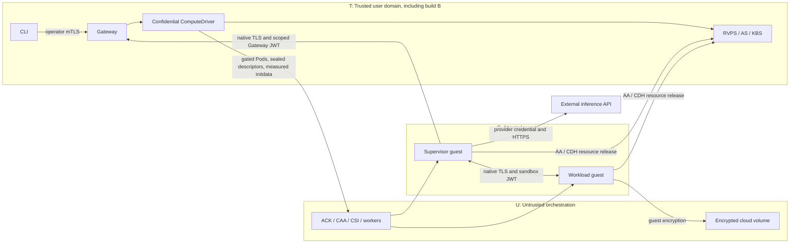

# Architecture and trust boundaries

Confidential OpenShell runs the unmodified OpenShell v0.1.6 Gateway, CLI and
supervisor with an external confidential Kubernetes ComputeDriver. The coding
workload uses the unmodified, digest-pinned OpenShell Community base image,
which includes OpenCode, Codex, Claude Code and their developer tools.
The guest uses the official Ubuntu mkosi/UKI flow and commit-pinned upstream AA/CDH;
Trustee provides appraisal and key release at the matching migration pin. Integration hooks add measured
OpenShell bootstrap and encrypted persistent workspaces. Native OpenShell owns
TLS, sandbox JWTs, RPC authorization and the supervisor/workload protocol.

Native OpenShell generates TLS and JWT signing state through its Kubernetes
initialization Job/cert-manager or standalone certificate generator. This profile
uses the released generator on T and seals guest bootstrap instead of distributing
plaintext credentials through Kubernetes Secrets. See the pinned
[Helm deployment](https://github.com/NVIDIA/OpenShell/blob/v0.1.6/deploy/helm/openshell/README.md)
and [certificate generator](https://github.com/NVIDIA/OpenShell/blob/v0.1.6/crates/openshell-server/src/certgen.rs).

The trusted user domain **T** contains build execution role **B**, the operator
CLI, Gateway, driver and its private authorization journals, and Trustee
AS/KBS and AS's built-in RVPS. Trustee may run on a separate trusted host.
The driver publishes resources and policies through authenticated KBS management
APIs; its private staging and recovery journal are never shared with Trustee.
KBS proxies policy and reference administration to AS. The deployment owns a
dedicated KBS resource policy and AS default CPU policy; multiple independent
policy writers are not supported. KBS and Gateway expose authenticated TLS endpoints
reachable by the cloud guests. Their addresses do not define the trust boundary.
The official Trustee images run without source changes.

T belongs to the user and is deployed on user-trusted systems, such as an on-premise
host. ACK and the cloud provider do not need administrative access to it. If the
cloud host administrator is in the adversary model, an ordinary ECS VM cannot
supply this trust merely because the user owns the account.

Developers run the native CLI on their trusted machines and reach the Gateway's
public TLS endpoint in T.

T reaches ACK through the selected public API or an explicitly routed private
connection. Guests reach Gateway/KBS and the image registry through authenticated
TLS at user-provided reachable addresses. A private address, public address, VPN
or TCP forwarding route is a transport choice. Forwarding through an untrusted
relay must preserve TLS termination and private keys inside T.

The untrusted orchestration domain **U** contains ACK, its control plane and
workers, CAA and CSI. It can replace Pod specifications, images, userdata and
initdata, or delay and deny service. The measured guest and trusted authorization
paths bind those inputs before releasing bootstrap plaintext or workspace keys.
The two TDX guests form domain **G**: supervisor and workload run separately
from the same immutable image. Physical placement on cloud hosts does not place
G in U. Platform policy pins approved MRTD and three static RTMR0 event digests,
with the exact six event types, names and order. Dynamic ACPI contents are accepted
untrusted VMM input handled by trusted TDVF/kernel, not independently approved
references. New-UKI-derived RTMR1, full RTMR2, replay of all four quoted RTMRs,
non-debug attributes and exactly one current initdata AAEL entry remain required.
These controlled values are not a general production firmware approval process.

Resource isolation is between guest roles. This guest profile uses AA/CDH ttRPC
and disables REST activation (`api-server-rest.path`) by default. This service
setting does not isolate keys from a program with sufficient privileges inside
its own guest. Such a workload program can obtain its own workspace key;
this design does not isolate that key from programs inside the workload guest.
KBS rejects resources bound to the other role. Provider credentials are delivered
to the supervisor and remain outside the workload's resource bindings.

| Path | Contract |
| --- | --- |
| Control | Gateway calls the external driver over its private socket. The driver creates gated role Pods, derives Kata policy from T-owned launch templates after checking admitted Pods, commits authorization and verifies Pod identity before releasing scheduling gates. Kubernetes receives sealed descriptors and references. |
| Attestation and release | Exact initdata bytes bind role, generation, attempt, Sandbox CR UID and resources. AA measures initdata once; AS checks quote, boot and AAEL; KBS authorizes the exact resource under the driver's current bindings. Kubernetes delivers signed vault descriptors through normal Secret mounts; Kata invokes CDH to verify and unseal them inside the guest. |
| Gateway authentication | Operators present their native client certificate. Supervisors verify the Gateway's server CA and present native sandbox-scoped JWTs. The driver seals launch/session credentials, per-role TLS server keys and public trust material; the operator client private key never enters either guest. Anonymous user access is disabled. |
| Workload channel | New workload generations establish the native control connection to their dedicated supervisor. The supervisor still verifies the workload's TLS server identity and authenticates with the native sandbox JWT. A per-sandbox NetworkPolicy permits only that pair's control flow and is bound into the generation's evidence. The workload’s in-guest seccomp/network broker mediates outbound connections; namespace and driver fences provide additional isolation. |
| User environment | Template and `--env` values enter the existing sealed workload configuration and reach child processes after CDH/KBS release. Kubernetes receives descriptors without those values. A private namespace/CR-UID record on T preserves them across stop/start. |
| Storage | The measured workload initializer obtains its key through CDH/KBS and initializes new LUKS volumes with stock cryptsetup. Released CDH SecureMount reopens encrypted volumes. The key identity remains stable for namespace and Sandbox CR UID; each attempt receives a new release binding. CSI owns disk lifecycle metadata. |
| Model requests | The supervisor obtains the attached provider credential at runtime and uses the approved HTTPS endpoint. The external inference service receives requests and is outside this confidential boundary. |

Supervisors authenticate with sealed launch JWTs and native refresh. The driver's
`AuthenticateSandbox` rejects host-controlled ServiceAccount credentials before
TokenReview or Kubernetes API access. `supports_sandbox_authentication=true` stays
enabled because Gateway also uses it to persist the runtime identity needed for
stop/start; see the [driver contract](../components/confidential-driver/README.md#bootstrap-resources).

Attestation determines who receives a credential; subsequent TLS requests
authenticate its holder without fresh hardware appraisal at connection establishment. A copied credential
could authenticate elsewhere until it expires or the native authorization state
rejects it. KBS revocation blocks future unseal; it cannot retract credentials or
plaintext already delivered. Keep sealed files guest-private, use fresh attempt
bindings, and stop/delete the native runtime when revoking an active run.
Native checks of `auth_epoch` and the current JWT `jti` reject subsequent protected RPC authentication;
an already open stream is not authenticated again on every frame.

Guest startup validates initdata, measures it through AA before CDH release, and
then starts Kata/APF. Official daemons and units are reused with small measured
integration drop-ins; invalid initdata blocks startup. The AS EAR signer and
dynamic AS/KBS policy remain necessary for attestation-gated key release.

The current stage permits TCB `UpToDate` and `OutOfDate`; valid quote verification,
non-debug attributes, approved measured boot and current initdata remain required.
Snapshot rollback protection and unique-VM identity remain outside this stage.

Each deployment must check both roles, KBS resource decisions, native TLS/JWT and
network enforcement, workspace restart and owned-resource cleanup; see the
[deployment checks](deployment.md#10-verify-both-confidential-roles).
